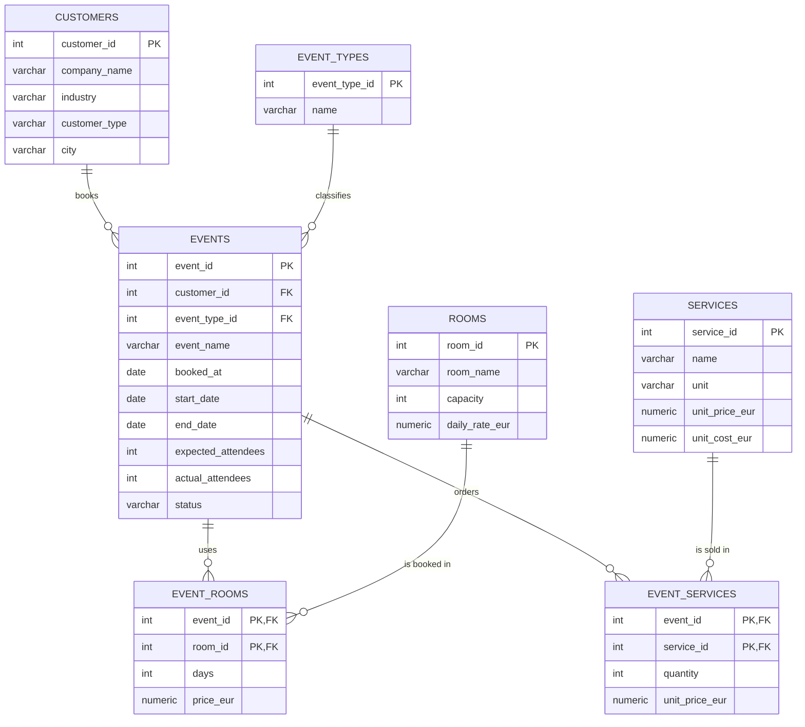

# ER Diagram

GitHub renders this Mermaid diagram automatically.

## Design decisions

- **3rd normal form.** Event types, rooms and services are separate lookup tables, so a name or price lives in exactly one place.
- **Two bridge tables (M:N).** An event can use several rooms (`event_rooms`) and order several services (`event_services`).
- **Historical prices are stored in the bridge tables.** `event_services.unit_price_eur` keeps the price *at booking time*, so a later price increase in `services` doesn't change past revenue.
- **Constraints in the database, not just in code.** `CHECK` constraints stop impossible data (end before start, negative capacity, unknown status).
- **A view for reporting.** `v_event_financials` hides the joins, so the analysis queries and the dashboard stay simple.
